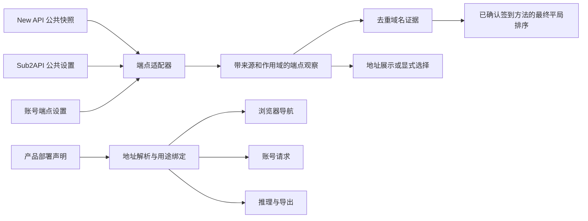

# 产品端点能力与签到元数据统一设计

Status: ready-for-agent

## 当前批准的实施范围

2026-11-15 用户将实施范围收敛为签到所需部分：公开域名元数据读取、New API/Sub2API 转换、签到平局排序，以及注册签到方法的多语言展示描述。只扩展这些读取/展示所需的既有 capability 和 registry，不执行本文后续的全局端点、请求映射、认证、存储、重复判断或导出迁移。

TDD 沿用已讨论的公开接口：`discoverCheckInMethods` 检验实际协议发现/元数据/选择及 transport 认证范围；`getCheckInMethodPresentation` 检验注册方法的用户文案。两者与用户刚确认的签到范围一致。失败/超时、手动选择、同级未知阻塞和存储读回复用已有回归，新增 Sub2API 原生公开包裹及多语言来源验证。

下面的完整端点模型保留为后续设计参考；其四步全局迁移不属于本次授权。当前实施与验收证据放在本 feature 的 `artifacts/checkin/`，仅本地保留。

当前实现使用 `SiteEndpointMetadata` 与 `site.endpointMetadata` 名称。最小产品投影是 `apiUrls: readonly string[]`；接口只提供公开观察，当前仅签到消费。New API/Sub2API 适配器负责原生包裹和字段，完整 HTTP(S) 地址先归一化，签到再投影 hostname。读取失败或相关字段错误保持平局；没有地址的有效公开快照仍可提供当前域名证据。没有实施长期模型中的端点用途绑定或账号 metadata reader。

2026-11-15 公开 GET 核对：`https://codexcli.club/api/v1/settings/public` 返回 `code: 0`，`api_base_url: https://codexcli.club/v1`，自定义端点 `https://api.codexcli.club/v1`；`https://xingya.space/api/status` 返回成功与 `.site/.space` 两个 `api_info` 地址。它们是动态字段/地址提示证据，未验证跨域 Cookie、账号等价或领取。用户指出来源地址漏项后，逐一复核全部 13 个 Sub2API 方法的调查记录、关联 issue、上游来源声明及公开设置，补齐如下地址；品牌官网、文档、其他未适配站点和无关的 Sub2API 上游演示不作为某个方法的域名线索。

方法展示统一从 registry 的 typed presentation 投影读取；所有来源名及普通/登录签到名称、说明归入八语言一致的 autoCheckin.methods，表单只保留操作提示。根据用户追加的语义，Xingya 与 AgentRouter 均是相对于 New API/One API 的第三方站点扩展；来源与 daily/login 动作类型独立，使用通用模板，不保留这两站独有的翻译分组。其他来源分类和原 sourceName 保持原值，15 个具名来源都经过同一 i18n 路径。界面布局、签到原生协议、执行与重放策略保持既有合同。

## 签到来源地址核对

以下是来源域名提示，不是候选允许列表、支持声明、控制台别名或凭据适用范围。以已确认协议为前提，当前 hostname 与公开 API 地址可以参与同级平局排序；AI-ROUTER 原有控制台候选限制保留。新增公开 API 域名不会产生跨域请求。

| 方法来源 | 已有记录、声明或公开设置中的地址 | 依据 |
| --- | --- | --- |
| Sub2API Pro | `demo.sub2api.org`（fork 声明的演示部署） | [pinned fork README](https://github.com/jiangmuran/sub2api_pro/blob/3f8585707632c959ca36be84e13c5a738c005a83/README.md#demo)；[#1270](https://github.com/qixing-jk/all-api-hub/issues/1270)、旧 [PR #1229](https://github.com/qixing-jk/all-api-hub/pull/1229) 和 [上游 PR #510](https://github.com/Wei-Shaw/sub2api/pull/510) 只有协议来源，没有其他部署地址 |
| Genius Programmer | `codexcli.club`、`api.codexcli.club` | [原调查](../genius-programmer-checkin/research.md)；公开设置 api_base_url/custom_endpoints |
| ToolCode | `toolcode.top`、`toolcode.cc`、`api.fasttoken.top` | [#1556](https://github.com/qixing-jk/all-api-hub/issues/1556)；公开设置的默认/两个备用 API |
| Denxio | `api.denxio.top` | [#974](https://github.com/qixing-jk/all-api-hub/issues/974)、[#1087](https://github.com/qixing-jk/all-api-hub/issues/1087)、[#1088](https://github.com/qixing-jk/all-api-hub/issues/1088)；现有协议调查 |
| Hiyo Free | `free.hiyo.top`、`codexfree.xiaotuxp.com` | [#1629](https://github.com/qixing-jk/all-api-hub/issues/1629)、[#1664](https://github.com/qixing-jk/all-api-hub/issues/1664)；公开设置的 CDN API 地址 |
| 小白Code | `token.dialoguedui.com`、`img-api.dialoguedui.com` | [#1575](https://github.com/qixing-jk/all-api-hub/issues/1575)、[#1581](https://github.com/qixing-jk/all-api-hub/issues/1581)、[原调查](../xiaobai-code-checkin/research.md)；公开设置的默认/生图 API |
| AI-ROUTER | `ai-router.dev`、`www.ai-router.dev`、`api.ai-router.dev` | 既有部署映射、[原调查](../ai-router-adaptation/research.md) 与公开设置；API 地址只增加排序提示 |
| Clawhud | `api.clawhud.com` | [#1670](https://github.com/qixing-jk/all-api-hub/issues/1670)；公开设置 custom_endpoints |
| DaiGua | `api.daigua.icu` | [#1622](https://github.com/qixing-jk/all-api-hub/issues/1622)、[原调查](../daigua-checkin/spec.md)；公开设置 |
| Sidrune | `global.sidrune.ai`、`cn.sidrune.ai` | [#1688](https://github.com/qixing-jk/all-api-hub/issues/1688) 的 `sidrune.ai` 是币种/站点选择页，直接链接两个控制台；两站公开设置均为 Sidrune AI。选择页本身不加入签到来源地址提示 |
| NexaVlinks | `asia.nexavlinks.com`、`ai.man8out.com`、`www.nexavlinks.com` | [#1553](https://github.com/qixing-jk/all-api-hub/issues/1553)、[原调查](../nexavlinks-checkin/spec.md)；当前公开设置声明两加速/国际直连 API 地址；不能据此将原营销站当成控制台 |
| FreeAPI | `freeapi.site` | [#1703](https://github.com/qixing-jk/all-api-hub/issues/1703)；公开设置 |
| 柏API | `byeapi.top`、`api.byeapi.top` | [#1746](https://github.com/qixing-jk/all-api-hub/issues/1746)、[原调查](../byeapi-checkin/research.md)；公开设置 api_base_url |

本次公开读取均为 2026-11-15 无认证 GET：除 Denxio 返回 502、Sub2API Pro 演示返回 521 外，上表读取的 `/api/v1/settings/public` 均返回 200。故 Denxio 仍沿用已有部署证据；Pro 演示仅有 fork 的明确来源声明，未验证其当下是否部署签到路由。Sidrune 两币种账户等价、备用 API 上的登录/签到也没有验证；本次只读取原站声明，从未使用凭据访问新地址。相关摘录与失败状态本地保留在 `artifacts/checkin/`。

回归通过 `discoverCheckInMethods` 验证 12 个非限定来源的 21 个地址分别作为当前站点/公开 API 地址解开已确认平局，镜像候选仍可用且无执行请求；另验证 AI-ROUTER API 地址计入重合数但控制台候选限制保留。

设计日期：2026-11-15。当前分支基线：`653620204c734d2817b6a24a22bfe4cd23deb87b`。
下述完整类型与模块位置为长期目标契约。当前仅顶部所列签到部分进入实现，其余运行时迁移仍保留为计划。

## 产品目标

把已存在的部署地址、动态 API 地址和签到域名提示放到产品自己的模型里。调用方使用端点用途和证据范围，不读取 `api_info`、`api_base_url` 等上游字段。

用户添加账号时仍选择实际登录的站点。扩展按任务取得控制台、账号 API 或指定推理协议的地址；发现的备用 API 地址可供解释或后续选择。签到发现先确认协议，再用统一端点证据解开同级平局。各签到方法通过同一描述契约提供多语言名称、来源和帮助说明。

范围包括现有 New API/Sub2API 动态信息，以及已有多域名、分域、路径挂载、协议差异、账号作用域端点。增加新的端点选择界面、自动故障切换或账号合并需要独立产品任务。

## 已有情况与证据

下表是当前仓库实现及其保留的调查证据。已有注释中的部署验证日期分别属于各集成，不表示此次重新验证了登录、凭据或线上写操作。

| 情况 | 已有实例 | 模型必须表达的事实 |
| --- | --- | --- |
| 单域名同时提供控制台和 API | 默认 New API/Sub2API | 同一地址可承担多个用途，推理协议仍单独声明 |
| 控制台与账号 API 分域 | AI-ROUTER | `ai-router.dev` 的请求映射到 `api.ai-router.dev`；公开设置不能解决最初 API 尚不可达的循环依赖 |
| 控制台、账号 API、推理三域 | Requesty、Grsai、Vercel AI Gateway | 保存站点、管理请求和外部推理配置取得不同地址 |
| 同服务多个控制台域名 | Grsai、LaoZhang | 已有等价证据可以支持部署声明；Cookie 和凭据适用范围仍由认证契约决定 |
| 同程序、同类型、多个账号部署 | `pmcat.top`、`pap.pmcat.top` | 两个部署保留独立账号 URL、登录和重复判断 |
| 相同适配器家族的区域服务 | Kimi、Kimi Global | 不同 Site Type、部署、账号和推理地址，家族共享不合并账号 |
| 同控制台存在多个推理线路 | Krill、Daya | 默认地址和备用地址分别表达；公开 API 地址不加入控制台识别 |
| 域名/协议相似但账号等价未验证 | Xingya `.site/.space`、AI-ROUTER VIP 门户 | 作为观察或发现提示；不能据此合并账号或扩大登录范围 |
| 同域名、不同路径用途 | NanoGPT | `/api/auth/*`、`/api/management/v1`、`/api/v1` 保留各自用途 |
| 路径前缀和 SDK 地址形态 | OpenRouter、EMRank、Ark | 保留 `/api/v1`、供应商路径、协议 root/mount，不能只存 origin |
| 多种推理协议与挂载地址 | FreeModel、FoxCode、Cubence、Ark Coding Plan | OpenAI、Anthropic 等各有地址；协议版本规则复用既有 owner |
| 一个账号的管理功能采用不同地址/凭据 | AI/ML API、Novita | 账号身份、密钥、余额等可绑定不同端点；端点角色不替代认证策略 |
| 同一主域名承载多个产品/团队 | Vercel | hostname 命中是候选；路径、产品及 team 身份不能丢失 |
| 自托管于端口或子路径 | 通用 New API/Sub2API 输入 | 部署匹配和请求地址保留 scheme、port、path；域名排序可以另作 hostname 投影 |
| 没有控制台的直接推理地址 | 已有 Ark 推理地址映射 | 允许仅声明 inference 端点，不虚构账号站点或 Site Type |

代码依据：

- [部署映射与 AI-ROUTER/Requesty](../../src/constants/deploymentApiOrigins.ts)、[AI-ROUTER 调查](../ai-router-adaptation/research.md)。
- [站点地址、部署与凭据说明](../../src/services/accountSiteDefinitions/identifiers.ts)、[站点定义](../../src/services/accountSiteDefinitions/definitions.ts)。
- [现有地址解析](../../src/services/accounts/accountSiteProfile/addresses.ts)、[存储/重复/导出 URL 策略](../../src/services/accounts/accountSiteProfile/urls.ts)、[协议地址规则](../../src/services/aiApi/protocolAddress.ts)。
- [Novita 多凭据地址](../../src/services/apiService/novita/constants.ts)、[Krill 账号端点设置](../../src/services/apiService/krill/constants.ts)。
- [现有签到元数据读取](../../src/services/checkin/autoCheckin/discovery/discovery.ts)、[方法声明](../../src/services/checkin/autoCheckin/providers/registry.ts)、[方法展示](../../src/features/AccountManagement/components/AccountDialog/checkin/checkInPresentation.ts)。
- [Xingya 部署观察与排序约束](../xingya-checkin/spec.md)。

Sub2API 动态字段核对于官方源码 `530c5e3a4f9c73ca2b0881191d0ef8e0d82c5484`：
[公开 DTO](https://github.com/Wei-Shaw/sub2api/blob/530c5e3a4f9c73ca2b0881191d0ef8e0d82c5484/backend/internal/handler/dto/settings.go#L367) 暴露 `api_base_url` 和 `custom_endpoints[]`，其中自定义项包含 `name/endpoint/description`；
[设置读取](https://github.com/Wei-Shaw/sub2api/blob/530c5e3a4f9c73ca2b0881191d0ef8e0d82c5484/backend/internal/service/setting_public.go) 将配置投影到公开设置。
设计基线的 [Hub DTO](../../src/services/apiService/sub2api/type.ts) 尚未声明这两个字段；本次签到范围已补齐字段，并由 [Sub2API 端点元数据适配器](../../src/services/apiAdapters/sub2api/siteEndpointMetadata.ts) 提供产品投影。
New API 的 `api_info[].url` 已由上述签到读取使用；它是已观察的部署扩展，不能假设所有 New API 版本必然提供。

## 领域结构

采用 [CONTEXT.md](../../CONTEXT.md) 中的 Service Deployment、Site Endpoint、Endpoint Declaration、Endpoint Observation。



这里的 Deployment 是实例身份，不是新站点类型。已知部署可有稳定声明 ID；未注册的自托管实例以当前站点 URL 范围识别。远端声称的其他域名不成为这个实例的账号身份别名。

### 产品契约

下面是设计类型；最终实现应引用现有协议、请求上下文、身份及翻译类型。
字符串中的 URL 必须经过统一 HTTP(S) 解析；不要通过类型断言把任意字符串当成已经验证的地址。

```ts
type InferenceProtocol = "openai-compatible" | "anthropic" | "google"

// base 保留完整挂载前缀；operation/page 保留完整目的地址。
type EndpointAddress = {
  kind: "base" | "operation" | "page"
  url: string
}

type EndpointText =
  | { kind: "message"; key: string }
  | { kind: "literal"; value: string }

type SiteEndpoint = {
  id: string
  address: EndpointAddress
  label?: EndpointText
  description?: EndpointText
} & (
  | { role: "console"; protocol?: never }
  | { role: "account-api"; protocol?: never }
  | { role: "inference-api"; protocol: InferenceProtocol | "unknown" }
  | { role: "unclassified-api"; protocol?: never }
)

type DeploymentSelector =
  // 迁移旧 hostname 规则时保留其现有匹配行为。
  | { kind: "hostname"; hostnames: readonly string[] }
  // 新的端口/子路径实例使用 URL 范围；路径按段匹配。
  | { kind: "url-scope"; origin: string; basePath: string }

type EndpointDeclaration = {
  deploymentId: string
  selectors: readonly DeploymentSelector[]
  endpoints: readonly SiteEndpoint[]
  // 值引用本声明内的 endpoint ID。额外功能绑定由现有适配器持有。
  defaults: {
    console?: string
    accountApi?: string
    inference?: Partial<Record<InferenceProtocol, string>>
  }
}

type EndpointObservationScope = {
  siteType: string
  browserBaseUrl: string
} & (
  | { kind: "site" }
  | { kind: "account"; accountIdentityKey: string }
)

type EndpointObservationSource = {
  kind: "public-metadata" | "account-metadata"
  readerId: string
  requestedUrl: string
  observedAt: number
}

type SiteEndpointMetadataResult = {
  scope: EndpointObservationScope
  source: EndpointObservationSource
} & (
  | {
      outcome: "known"
      endpoints: readonly SiteEndpoint[]
      complete: boolean
      issues: readonly {
        field: string
        reason: "absent" | "invalid-type" | "invalid-url" | "truncated"
      }[]
    }
  | {
      outcome: "unavailable"
      reason: "unsupported" | "request-failed" | "invalid-response"
        | "timeout" | "cancelled"
    }
)
```

类型约束之外，声明注册时验证 ID 唯一、引用存在、默认用途/协议相容、selector 不冲突；不依靠声明数组顺序选择赢家。一个 URL 可有多个角色记录，消费者投影时去重。相同 origin 的不同路径、不同协议端点仍保留独立记录。

`EndpointAddress.kind` 描述地址形态，不描述可信度；`role` 描述用途，不描述凭据可用性。`unclassified-api` 可以用于域名证据或原样展示，不能作为账号/推理默认地址。`inference-api` 的 `unknown` 协议也不能自动变成 OpenAI 地址。

`defaults` 只表达当前产品已选择的默认地址。AI/ML API、Novita 的身份/密钥/余额等操作通过已有适配器引用不同声明端点，认证和原生 operation path 保留在原来的 capability 中。端点模型不建立一份覆盖全部供应商原生操作的全局路由表。

账号保存 URL、重复判断、默认认证、Cookie 域、team 身份和 credentials 各有原 owner；迁移时可以引用同一部署声明，但这些策略不从 endpoint 列表自动推导。已存在的 canonical storage/duplicate 规则必须原样保留。

### 明确的配置实例

Requesty 的声明包含 `console = https://app.requesty.ai`、`management = https://api-v2.requesty.ai`、`openai = https://router.requesty.ai/v1`；分别绑定三个默认用途。新增镜像控制台必须说明其部署归属和已验证的请求映射。

PM-API 保持一个 Site Type，声明 `pmapi-public` 与 `pmapi-invite` 两个部署，各自匹配 `pmcat.top` 与 `pap.pmcat.top`。两个声明不能被拼成一个账号别名集合。

Xingya 的已知两域目前可以声明为某签到来源的 `domainHints`。除非补充跨域账号/登录证据，它们不进入账号等价、认证或自动改写的声明。使用其他域名部署同一已确认协议的站点仍可参与发现。

## 能力接口与职责

延伸既有 `SiteTypeCapabilities`：

- `site.endpoints.readPublicMetadata(context)`：公开只读观察。Context 只接受站点 URL、浏览器分区/请求上下文、deadline 与 signal，不接受 token、Cookie、任意认证 headers。
- `account.endpoints.readMetadata(context)`：确有账号作用域设置时单独声明，例如 Krill。Context 引用现有账号身份和认证请求契约，观察绑定该账号。后台签到的公共平局排序不调用这个入口。
- 缺少入口代表未适配这个读取能力；某版本端点确实不存在才返回 `unsupported`。错误或不完整响应不转换成空列表。

默认地址继续由现有 `resolveAccountSiteAddresses` 及 transport 的纯部署解析负责。共享模块负责 URL 解析、作用域校验、去重和域名投影；能力适配器负责上游包裹、字段、用途判定和认证读取方式。调用方不选择或探测观察中任意地址。

公开设置可能同时提供站名、引导和端点信息。尽量复用同一次已通过协议校验的快照，分别产生 bootstrap facts 和 endpoint observation；使用同一尝试/范围的现有请求复用机制。端点字段损坏不丢弃可用的站名，站名存在也不证明端点字段有效。不要为这次迁移建立无作用域的全局快照缓存。

### 上游转换

| Reader | 输入 | 产品输出 | 读取与用途规则 |
| --- | --- | --- | --- |
| New API 部署扩展 | `GET /api/status` 的 `data.api_info[].url` | 公开端点观察 | 默认 `unclassified-api`；只有经过验证的部署字段契约才能增加用途 |
| Sub2API | `GET /api/v1/settings/public` 的 `api_base_url` | 公开端点观察 | 上游显示的 API 基址；不认定为账号管理地址或控制台别名 |
| Sub2API | `custom_endpoints[].endpoint/name/description` | 多个地址及远端显示文本 | 远端文字为 `literal`；描述中的线路/协议字样不当成机器协议标记 |
| Krill 等账号设置 | 原生账号端点字段 | 账号范围观察 | 由具体适配器根据已验证契约标记 inference 用途，保留账号身份范围 |
| 当前账号输入 | 浏览器站点 URL | 本地域名证据 | 独立于远端返回；保留账号、路径和尝试归属，不伪装成上游声明 |

New API/Sub2API 通用 reader 首轮只投影地址证据。Daya 等已有确切推理用途的适配器可额外给出已验证角色，但动态观察不会覆盖产品默认值。普通菜单、文档、客服、购买链接均不转换为 API 端点。

### 归一化和观察状态

1. 声明的已验证地址先解决请求 bootstrap，再读取该部署的公开信息。不能先靠未知 API 返回的 `api_base_url` 才决定去哪个 API 读取它。
2. 只接受绝对 HTTP(S) URL，保留 scheme、port、路径大小写和前缀。相对路径仅在某 reader 的字段契约明确规定基准时解析；未规定的值忽略。禁止由通用模型自动猜 `https://` 或把裸域名当作绝对地址。
3. URL 中有 userinfo 或 query 时不纳入发现证据，避免把带凭据或临时签名的链接当成可复用基址。远端 API 地址的 fragment 不参与基址；含 fragment 的非基址地址由 adapter 明确分类。console page 导航允许既有声明中的 hash 路由。
4. 先归一化，再按地址形态、用途和协议去重；域名证据另外按小写精确 hostname 去重。域名计分忽略端口和路径，不代表账号身份或请求解析忽略它们。禁止顶级域/后缀/同品牌猜测。
5. 解析到无效项时跳过该项，保留其余可用地址；缺字段、显式空数组、错误类型和请求失败分别记录。`issues` 解释缺失或被拒绝的字段，显式空数组无需 issue。相关字段错误类型或未完整取得时设 `complete: false`；处理完但不满足 URL 契约的项可作为 `invalid-url` 排除。`known + [] + complete` 表示成功观察到没有有效地址；`unavailable` 表示未取得可靠观察。
6. 若读取范围、分页或预算导致列表截断，设 `complete: false`，不把前一部分用于决定最高重合数。共享读取预算遵循原 transport 限制，签到正整数计分仍遵守现有 32 上限；溢出时整组保留平局。
7. 不访问远端列出的 URL，不自动扩大浏览器权限、跳转登录、改 Cookie 范围、试发凭据或切换出口。地址的请求、导出或账号归属资格分别由已有产品/认证策略决定。
8. 取消、超时、账号编辑或尝试替换后，旧观察不发布到新草稿。公开观察按站点/分区范围复用，账号观察另按账号身份复用。初次迁移不增加持久化地址列表。

## 签到消费及多语言结构

发现顺序保留为：

1. Site Type、候选资格及已有 origin 排除规则决定探测范围；已验证的只读协议返回 `matched/unsupported/unknown`。
2. 专用协议优先于通用协议。更高优先级存在 unknown 或同级歧义时，不退到旧的自动通用选择；停用但确认为专用协议仍保留其支持事实。
3. 对最高优先级、已确认且没有未知同级阻塞的候选平局，才读取当前类型的 endpoint capability。协议探测、最终计分共用原 deadline。
4. 完整公开观察形成 `H = 当前站 hostname ∪ 有效公开端点 hostname`。每个方法的 `domainHints` 去重成 `K`，计算 `|H ∩ K|`。唯一、正的最高分才自动解决平局。
5. 同分、零分、观察失败/不完整、超时、取消或超界保持原结论。无 reader 的类型首轮迁移保持原选择行为。当前域名不因远端声明而拥有额外认证资格。
6. 手动选择、既有同级选择保留规则和状态解码按现有契约执行。计分仅附着当前 matched 证据，重探不保留旧分数；持久化仍只存已有有界分数，结果重开一致。

方法声明统一扩展以下内容，独立于执行 provider：

```ts
type CheckInMethodPresentation = {
  label: { key: string; source?: EndpointText }
  disclosure?: { key: string; source?: EndpointText }
}

type CheckInMethodDiscoveryMetadata = {
  priority: "specific" | "generic"
  domainHints: readonly string[]
  // 候选资格是独立政策，保持现有精确 origin 语义。
  eligibleOrigins?: readonly string[]
  excludedOrigins?: readonly string[]
}
```

`key` 在最终代码中使用现有 namespace 的类型化翻译键，并让现有提取器验证所有支持语言。source 的品牌名称可以是明确的固定专名，包含可翻译词义的名称用 message；远端描述仅原样显示，不能当成 translation key。官方、第三方分类继续供统计和说明使用，不承担方法优先级。

方法声明区分来源和动作类型，`getCheckInMethodPresentation` 使用 `autoCheckin.methods` 中通用普通/登录模板解析名称与说明。账号弹窗、重探反馈、列表与帮助消费同一结果，不再分散判断 method ID。路线覆盖、读回能力、签到登录和重放策略继续使用现有声明，不折叠成一个“通用签到执行器”。

已有部署地址在得到同一事实证明时，以声明 ID 或 leaf 常量引用生成提示，避免再次复制域名。只用于消歧而未经账号等价验证的来源可以单独保留 `domainHints`，并注明证据；提示永远不生成 `eligibleOrigins`。

## 模块归属与迁移顺序

选择扩展现有 owner，不另建一份并行的“别名总表”。

| 当前 owner | 目标职责与兼容处理 |
| --- | --- |
| `constants/deploymentApiOrigins.ts` | 扩展为产品部署声明与纯地址解析的依赖 leaf；保留旧 exports/wrappers 到消费者迁完。需重命名时移动这个 owner，不能复制出第二份映射 |
| `accountSiteDefinitions/identifiers.ts` 与 `definitions.ts` | 检测候选、站点/家族注册及 URL/auth 产品策略；已验证地址引用 leaf 声明。多个检测域不等于一个部署 |
| `accounts/accountSiteProfile/addresses.ts`、`urls.ts` | 浏览器/账号/推理地址的共享消费，保留 storage/duplicate/login 策略及 root/mount 返回契约 |
| `apiAdapters/contracts/siteTypeCapabilities.ts` | 声明 site/account 两种只读 endpoint capability |
| `apiService` 具体适配器 | 原生设置请求、包裹校验与字段转换，复用现有公开读取 |
| 新的最小 `services/siteEndpoints` 共享 owner | 观察模型、归一化、作用域与 hostname 投影；不引入全局账户、React 或 transport 配置依赖 |
| `checkin/autoCheckin/providers/registry.ts` | 方法展示/来源/发现描述，保留协议与政策差异 |
| `checkin/autoCheckin/discovery/discovery.ts` | 使用 endpoint capability，移除硬编码 New API `api_info` 读取 |

依赖方向必须保持：build/Jiti 配置、站点声明和 transport 只能读取纯 leaf；metadata reader 可以依赖 transport，transport 不能反向导入 reader/capability registry。协议地址转换继续由 `aiApi/protocolAddress.ts` 负责。

实施分四步，每步先写行为失败测试，完成相关验证后隔离提交：

1. **产品模型与纯解析**：扩展现有部署 owner；以 AI-ROUTER、Requesty、PM-API、协议挂载为代表证明旧行为等价。支持多个端点、精确 URL 范围和用途引用；声明没有映射的地址保持当前 fallback。
2. **动态 reader 与签到接入**：实现 New API/Sub2API 产品观察、作用域与异常状态，替换签到硬编码读取。Krill 账号入口按现有设置 reader 做代表性合同接入；其他尚未适配动态字段的部署保留明确状态，不声称已经覆盖线上读取。
3. **方法展示统一**：迁移全部注册签到方法到同一 presentation/discovery 描述；保持既有方法 ID、来源分类和文案含义，验证当前八种语言及所有 UI 消费者。
4. **现有地址消费者迁移**：清点已验证部署的重复事实，逐步迁移浏览器恢复、账号 transport、默认认证、重复比较、推理模型、verification 和外部导出，删除兼容 wrapper。Aihubmix、Grsai、Kimi、AI/ML API、Novita、NanoGPT 等需按各自实际 operation/credential 合同验证，不能一律将全部账号请求改到单一默认地址。

到第 4 步闭合前，只能报告已迁移消费者。`managedChannelOrigin` 目前可能承担兼容地址选择，必须逐调用方区分 account 与 inference 用途后替换，不能仅按字段名批量改写。

## 验收矩阵

| 行为 | 实施时必须通过的验证 |
| --- | --- |
| 静态声明/作用域 | 重复 ID、悬空/跨用途默认引用、selector 冲突失败；端口、子路径、路径段边界；未注册 URL fallback |
| 三类地址 | Requesty/AI-ROUTER 默认映射；Grsai/Vercel/Aihubmix 操作实际请求目标；保存 URL 与浏览器恢复维持既有规则 |
| 账号与凭据隔离 | PM-API、Kimi 区域、team、账号切换、Cookie/主副密钥保持范围；观察不会改认证策略 |
| 协议地址 | OpenRouter/Ark/Coding Plan root/mount；OpenAI/Anthropic 不互相覆盖；同 host 多 path 保留 |
| 公开 reader | 真实 transport 包裹；New API api_info、Sub2API base/custom 同 shape；空/缺失/损坏/相对 URL/带凭据 URL/重复项/截断；取消与 deadline |
| 公开认证范围 | 请求仅到当前已选择 API，保留浏览器分区，账号凭据及额外 headers 不转交；不访问广告端点 |
| 账号 reader | Krill 等账号快照不被另一个账号或公共签到消费；身份/尝试变化使晚到结果失效 |
| 签到发现 | 专用/通用双匹配、停用、unknown 阻塞、同级多匹配；正分唯一、零分、同分、32 上界、失败/超时；手动选择及保存重开 |
| 方法展示 | 全部注册方法及八语言键有效；Xingya/AgentRouter 特殊文案、第三方说明、错误/待确认/保存提示保持含义 |
| 所有既有消费者 | 定向 related Vitest、compile/knip、真实 build；代表性账号编辑 E2E、推理/managed/CLI 配置地址与认证检查 |
| 线上能力声称 | 动态字段源码不能证明同账号/凭据等价；声称新的线上行为时补部署专属只读或已授权操作证据及独立验收 |

本次设计验证已通过：16 个本地文档/代码链接检查，两个 TypeScript 契约块及分域、端口/路径、多协议、公开/账号作用域示例的 strict 类型校验，账号缺身份和未分类端点声称协议的负向类型检查，以及 Prettier 格式检查。这些检查不计作实现测试或 live acceptance。后续实现必须按上述迁移范围补 TDD、受影响消费者和独立验收。

## 取舍与保留材料

- 不采用纯 `aliases: string[]`：它无法表达 PM-API 独立实例、管理/推理分域、协议路径及账号范围。
- 不直接将两个上游响应取并集：字段名和包裹属于 reader，产品需要统一用途、来源、完整性和作用域。
- 不把动态列表作为路由优先级：它目前建立的是地址观察；bootstrap、凭据适用性、默认出口仍由已验证声明和用户配置决定。
- 不新增每部署一个 Site Type：自托管实例和 AI-ROUTER 已存在于家族/部署规则中；区域账号产品继续保留现有不同类型。
- 不创建全局可编排原生 operation 路由系统：已有适配器负责实际差异；共享端点结构只消除可验证的地址、归一化和元数据重复。

本 spec 与新增领域词条保留 Git，供后续实现和审查。此前 Sub2API 源码副本及 Xingya 发现日志保留在原任务忽略的 evidence 目录；精确上游 revision/链接已提取到本 spec。此次不产生新日志、截图或 API dump，也不清理其他任务材料。
