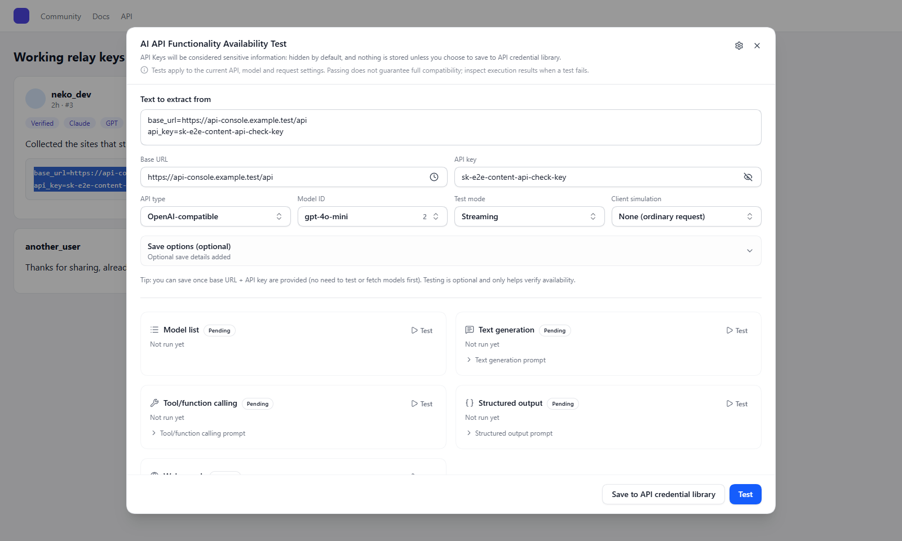
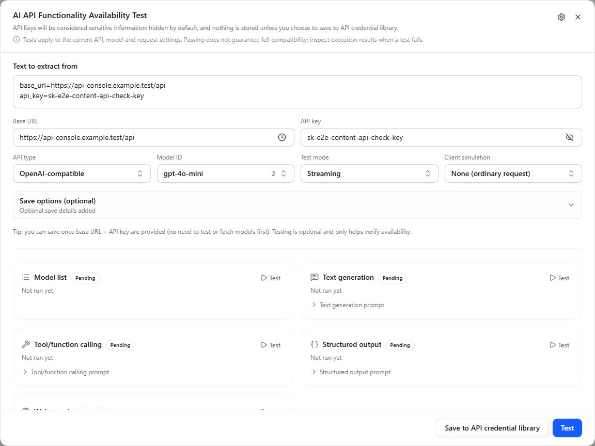
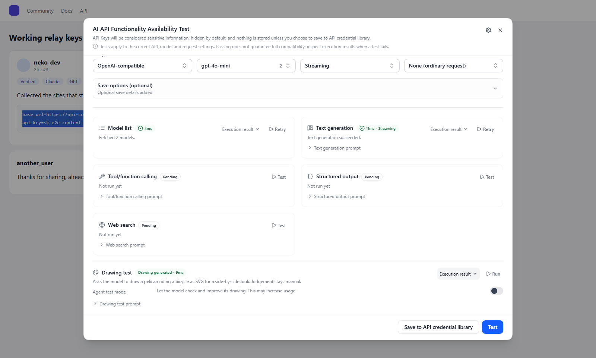

# Web API Testing

> Sniff `Base URL` and `API Key` on webpages and verify them instantly. Supports right-click checks and automatic detection with a configurable website scope.

## Background

When browsing AI communities (e.g., Linux.do), GitHub Issues, or technical documentation, you often encounter shared test keys. The traditional approach is to copy the `Base URL`, copy the `Key`, open the extension, fill in the configuration, and click verify.

The **Web API Testing** feature simplifies this process into:
- Select text → Right-click "Test selected AI API" → Choose a test in the panel.
- Or: Select or copy content containing credentials to receive a confirmation prompt.

## Core Capabilities

### 1. Right-Click Menu Check (Context Menu)
Select text containing a `Base URL` or `API Key` on any webpage, right-click, and select **"Test selected AI API"**. With nothing selected, right-click a blank part of the page and choose **"Open AI API test panel"** to enter the details in the panel.
The extension will attempt to extract valid interface information from the selected text (or clipboard) and pop up a test overlay within the current page.

### 2. Automatic Sniffing (Auto Detect)
By default, selection and copy actions on all HTTP/HTTPS pages can trigger detection of the selected or copied content. Opening a post alone does not scan the entire page.
- If a likely valid `Base URL + Key` combination is extracted, a lightweight prompt will pop up in the upper right corner of the page.
- Click the prompt to open the test dialog.
- Enhanced detection can also recognize Base64-encoded keys with known formats. If the API URL is missing, add it in the dialog before testing. Selected HTTP/HTTPS link destinations are included in extraction.

### 3. In-page Test Dialog
Perform the following operations without leaving the current webpage:
- **Automatic Extraction**: Automatically separate `Base URL`, `Secret Key`, and `API Type` from the source text.
- **Instant Testing**: Click "Start Test" to verify the connectivity of the key and available models.
- **Test mode**: Choose **`Streaming`** (the default) or **`Non-streaming`**. Generation tests use that mode without switching automatically on failure. Results and verification history saved to the API Credential Library show the mode used. Fetching the model list is unaffected.
- **Get Model List**: Fetch the full list of model IDs supported by the upstream site with one click.
- **Save to API Credential Library**: Once verified, save it with one click to the extension's [API Credential Library](./api-credential-profiles.md) for later copying, verification, or export to tools like CherryStudio.

The dialog splits the credentials into `Base URL`, `API key`, `API type`, `Model ID`, `Test mode`, and `Client simulation`. Each probe on the right runs independently and shows its latency once it passes; when one fails, expand **"Execution result"** to read the raw request and response.

### 4. Pelican drawing test

Run the drawing test in the same in-page panel to generate and preview an SVG of a pelican riding a bicycle with the selected model. Agent mode also tests artifact creation through tools. The screenshot uses a demo response and does not represent a model benchmark result.

## Configuration and Customization

Navigate to **`Settings → Basic Settings → Web API Testing`** to configure the following:

### 1. Basic Switches
- **Right-Click Menu**: Whether to show "Test selected AI API" and "Open AI API test panel". The browser shows the matching entry depending on whether content is selected.
- **Auto Detect**: Whether to detect selected or copied content on participating websites.

### 2. Website Black/White Lists
- **Whitelist**: When nonempty, only matching pages can prompt automatically. When empty, unlisted websites can also participate.
- **Blacklist**: Blocks automatic prompts on matching pages. With both lists empty, all HTTP/HTTPS pages are allowed by default.
- **Overlap priority**: When both lists match, use the selected blacklist-first (default) or whitelist-first policy.
- Long lists show three rules and a faded preview of the next rule. Expand or collapse each list independently. Enter a URL to preview the decision and reason locally without making verification requests.

### 3. Add and Edit Rules
- Click Add beside a list to open the editor. Paste multiple lines or select multiple browser-tab websites. Each pending rule has its own syntax; confirmation saves and deduplicates the batch.
- **Wildcard** (default): `linux.do` becomes `*://linux.do/*` and matches that host. `*.example.com` matches both the root domain and its subdomains. Use `https://example.com/private/*` to restrict the scheme and path. Omitting a port ignores the page port; an explicit port must match.
- **Exact URL**: Matches the complete URL, including query parameters and fragments. Shortcuts select the current page, whole website, or subdomains.
- **Regular expression**: Uses case-insensitive JavaScript RegExp. Unsafe or invalid expressions cannot be saved.
- Existing domain, path and regex rules retain their matching behavior. An existing empty restricted scope becomes an explicit block-all rule. On upgrade, an old empty allowlist without a configured scope becomes all websites; disabled switches remain disabled.
- Click Add or Save to persist changes. Invalid input, save failures and cancellation retain the draft; cancellation does not write rules. Use the inline edit and remove buttons for saved rules.

### 4. Control This Website from the Page
Click **Stop auto-detect on this website** in the notice to save a disabled choice for the current website. You can also open the check panel from the browser context menu and toggle **Auto-detect on this website**. This does not change the global switch. The lists and overlap priority still determine the effective result; open settings from the panel if a rule continues to block it. Manual context-menu checks remain independent of automatic-detection site rules.

## Privacy and Security

- **Local Extraction**: The sniffing and extraction process is executed entirely locally in your browser.
- **Request timing**: The selection or copy notice does not make API testing requests. After you confirm opening the panel with a complete URL and key, the panel may fetch models. Tests send requests to the configured `Base URL`.
- **Credential storage**: Extracted keys are persisted only when you choose to save them to the API Credential Library.

## Related Documents

- [API Credential Library](./api-credential-profiles.md): Manage saved sniffing results.
- [API Testing and Health Status](./auto-refresh.md): Learn how the extension verifies interfaces.
