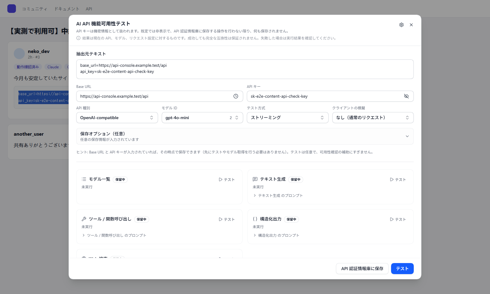
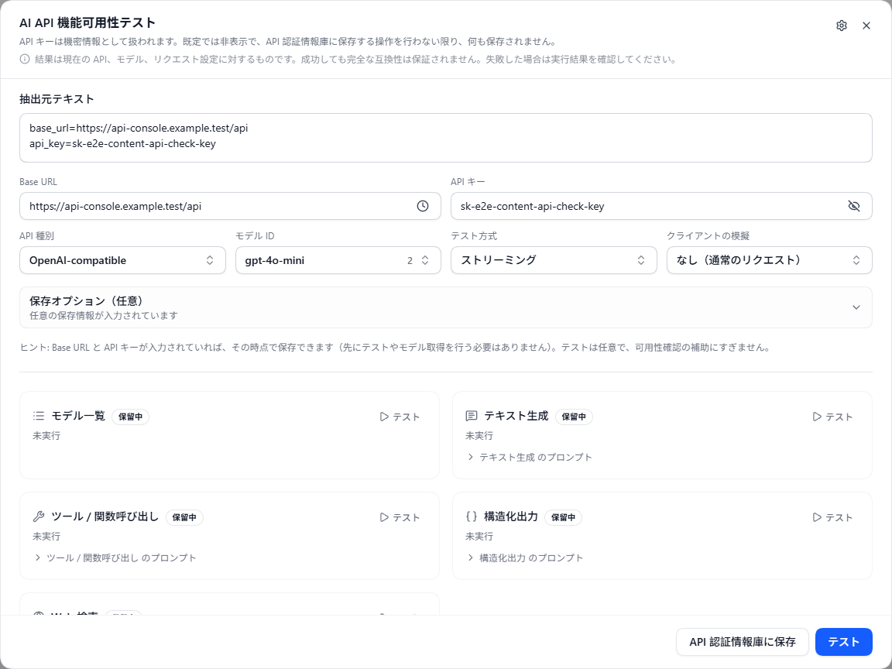
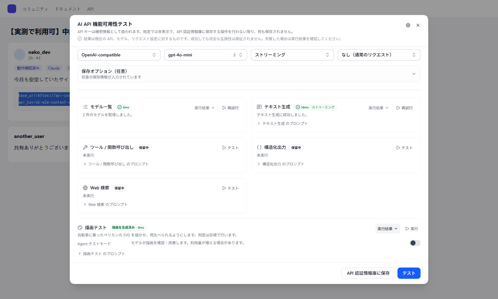

# ウェブページの API テスト

> ウェブページ上の `Base URL` と `API Key` を検出して検証します。右クリックによるチェックと、対象サイトを設定できる自動検出に対応しています。

## 背景

AI コミュニティ（Linux.do など）、GitHub Issues、または技術ドキュメントを閲覧しているとき、共有されたテストキーに遭遇することがよくあります。従来の方法は、`Base URL` をコピーし、`Key` をコピーし、拡張機能を開き、設定を入力して、検証をクリックすることでした。

「**ウェブページの API テスト**」機能は、このプロセスを次のように簡素化します：
- テキストを選択 → 右クリックで「選択した AI API をテスト」 → パネルでテストを選択。
- または：認証情報を含む内容を選択・コピーすると、確認メッセージが表示されます。

## コア機能

### 1. 右クリックメニューチェック (Context Menu)
任意のウェブページで `Base URL` または `API Key` を含むテキストを選択し、右クリックして「**選択した AI API をテスト**」を選択します。何も選択していない場合は、ページの空白部分を右クリックして「**AI API テストを開く**」を選び、パネルで情報を入力できます。
拡張機能は、選択したテキスト（またはクリップボード）から有効なインターフェース情報の抽出を試み、現在のページ内にテストオーバーレイを表示します。

### 2. 自動スニッフィング (Auto Detect)
既定では、すべての HTTP/HTTPS ページで選択・コピーした内容が検出対象になります。投稿を開くだけでページ全体をスキャンすることはありません。
- 有効と思われる `Base URL + Key` の組み合わせが抽出されると、ページの右上に軽量なプロンプトが表示されます。
- プロンプトをクリックすると、テストダイアログが開きます。
- 拡張検出では、既知の形式の Base64 エンコードされたキーも検出できます。API URL がない場合は、テスト前にダイアログで追加できます。選択範囲内の HTTP/HTTPS リンク先も抽出に使用します。

### 3. ページ内テストダイアログ
現在のウェブページを離れることなく、以下の操作を実行できます：
- **自動抽出**：ソーステキストから `Base URL`、`シークレットキー`、`API タイプ` を自動的に分離します。
- **即時テスト**： 「テスト開始」をクリックして、キーの接続性と利用可能なモデルを確認します。
- **テスト方式**：**`ストリーミング`**（既定）または **`非ストリーミング`** を選択します。生成系テストはその方式で実行され、失敗時に自動で切り替わることはありません。結果と API 認証情報庫に保存する検証履歴には、使用した方式が表示されます。モデル一覧の取得には影響しません。
- **モデルリストの取得**：アップストリームサイトでサポートされているモデル ID の完全なリストをワンクリックで取得します。
- **API 認証情報庫に保存**：検証されたら、ワンクリックで拡張機能の [API 認証情報庫](./api-credential-profiles.md) に保存し、後でコピー、検証、または CherryStudio などのツールへのエクスポートに使えます。

ダイアログは認証情報を `Base URL`、`API キー`、`API 種別`、`モデル ID`、`テスト方式`、`クライアントの模擬` の 6 項目に分解します。右側の各プローブは独立して実行され、成功すると所要時間が表示されます。失敗した場合は **「実行結果」** を展開すると、リクエストとレスポンスの生データを確認できます。

### 4. ペリカン描画テスト

同じページ内パネルで描画テストを実行すると、選択したモデルが生成する自転車に乗ったペリカンの SVG をその場でプレビューできます。Agent モードではツールを使った成果物の作成も確認できます。スクリーンショットはデモ応答を使用しており、特定モデルの評価結果ではありません。

## 設定とカスタマイズ

「**設定 → 基本設定 → ウェブページの API テスト**」に移動して、以下を構成します：

### 1. 基本スイッチ
- **右クリックメニュー**：「選択した AI API をテスト」と「AI API テストを開く」を表示するかどうか。選択内容の有無に応じて該当する項目が表示されます。
- **自動検出**：対象サイトで選択・コピーした内容を検出するかどうか。

### 2. サイトのホワイトリストとブラックリスト
- **ホワイトリスト**：空でない場合、一致するページだけが自動通知の対象になります。空の場合、一覧にないサイトも対象になります。
- **ブラックリスト**：一致するページの自動通知をブロックします。両方が空の場合、すべての HTTP/HTTPS ページを既定で許可します。
- **重複時の優先順位**：両方に一致する場合、選択したブラックリスト優先（既定）またはホワイトリスト優先を適用します。
- 長い一覧は最初の3件と次のルールのフェード表示を示します。各一覧を個別に展開・折りたたみできます。URL を入力すると、検証リクエストを送信せずに判定と理由をローカルで確認できます。

### 3. ルールの追加と編集
- 一覧横の追加ボタンで編集ダイアログを開きます。複数行の貼り付けやブラウザタブのサイトの複数選択に対応します。各行で構文を選び、確認すると重複を除いて一括保存します。
- **ワイルドカード**（既定）：`linux.do` は `*://linux.do/*` になり、そのホストに一致します。`*.example.com` はルートドメインとサブドメインに一致します。`https://example.com/private/*` でスキームとパスを限定できます。ポート省略時はページのポートを無視し、明示した場合は一致が必要です。
- **完全な URL**：クエリパラメーターとフラグメントを含む URL 全体に一致します。現在のページ、サイト全体、サブドメインのショートカットも利用できます。
- **正規表現**：大文字・小文字を区別しない JavaScript RegExp を使います。安全でない式や無効な式は保存できません。
- 既存のドメイン、パス、正規表現ルールは元の照合方式を維持します。既存の空の制限範囲は全件ブロックのルールになります。更新時、範囲未設定の古い空の許可リストはすべてのサイトに広がります。無効なスイッチは維持されます。
- 追加または保存をクリックして確定します。無効な入力、保存失敗、キャンセル時には下書きを保持し、キャンセルではルールを書き込みません。保存済みルールは行内の編集・削除ボタンで操作できます。

### 4. ページから現在のサイトを操作
通知の **このサイトで自動検出を停止** で現在のサイトを無効にする設定を保存できます。右クリックメニューから検出パネルを開き、**このサイトで自動検出** を切り替えることもできます。全体のスイッチは変更されません。実際の判定は一覧と重複時の優先順位に従うため、引き続きブロックされる場合はパネルから設定を開いて調整してください。手動の右クリックチェックは自動検出のサイトルールに制限されません。

## プライバシーとセキュリティ

- **ローカル抽出**：スニッフィングと抽出プロセスは、ブラウザ内で完全にローカルに実行されます。
- **リクエストのタイミング**：選択・コピー後の通知は API テストリクエストを送信しません。完全な URL とキーでパネルを開くことを確認すると、モデル一覧を取得する場合があります。テストでは設定した `Base URL` にリクエストを送信します。
- **認証情報の保存**：抽出したキーは、API 認証情報庫への保存を選んだ場合にのみ永続保存されます。

## 関連ドキュメント

- [API 認証情報庫](./api-credential-profiles.md)：保存されたスニッフィング結果を管理します。
- [API テストとヘルスステータス](./auto-refresh.md)：拡張機能がAPI をテストする方法について説明します。
