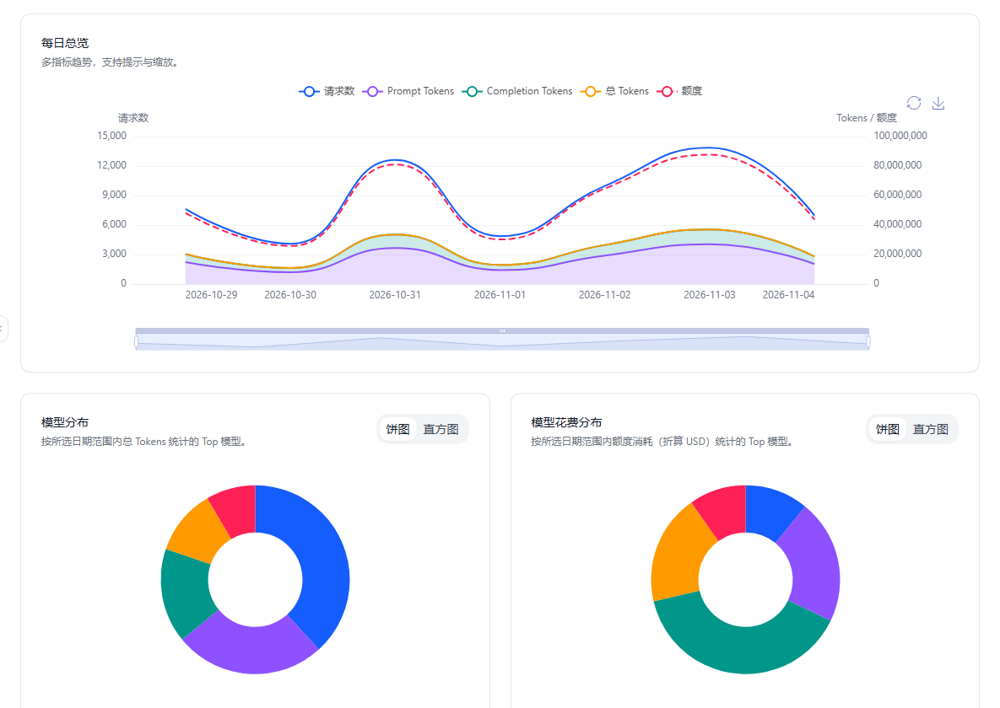
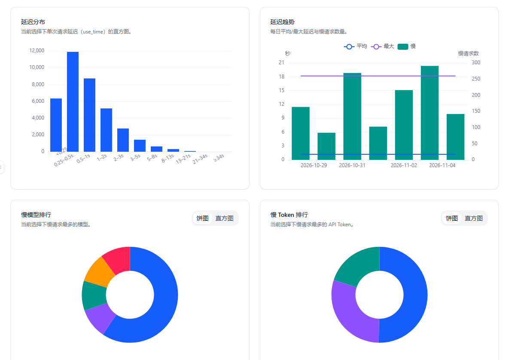

# 用量分析

> 把本地聚合的用量历史做成图表，帮助你回答几个实际问题：哪几个账号最耗量、哪些模型最花钱、请求主要集中在什么时间、最近是不是变慢了。

## 先理解它依赖什么

`用量分析` 不是实时抓原始日志，而是基于本地保存的 **用量历史聚合数据** 来展示。

因此第一次使用前，需要先到：

**`设置 → 基本设置 → 账号用量`**

开启用量历史同步，并先同步一轮数据。

## 功能概览

- **多维筛选**：按站点、账号、Token、日期范围过滤。
- **总览指标**：查看请求数、输入 / 输出 Token、总 Token、花费。
- **模型分析**：查看模型分布、模型花费分布、模型热力图。
- **时段分析**：查看使用时间热点，判断请求集中在哪些星期 / 小时。
- **延迟分析**：查看延迟分布、延迟趋势、慢模型排行、慢 Token 排行。
- **导出**：把当前筛选结果导出，便于对账或进一步处理。

## 第一步：开启用量历史同步

进入 **`设置 → 基本设置 → 账号用量`**，你会看到两块内容：

- **用量历史同步设置**
- **同步状态**

### 可以配置什么

| 项目 | 说明 |
|------|------|
| 用量历史同步 | 总开关 |
| 保留天数 | 本地聚合数据保留多久 |
| 自动同步方式 | 仅手动 / 账号刷新后 / 类 Cron |
| 最小同步间隔 | 控制自动同步频率 |

### 自动同步方式怎么选

- **仅手动**：最省请求，适合偶尔分析的人。
- **在账号刷新后**：适合日常使用，刷新账号时顺带积累数据。
- **类 Cron（需要 Alarms API）**：适合希望后台定时同步的人。

如果浏览器不支持 `Alarms API`，插件会自动降级，不会强行保留不可用的调度方式。

### 同步状态管理

在 **`设置 → 基本设置 → 账号用量 → 同步状态`** 中，你可以像管理“下载任务”一样管理用量同步：

- **状态总览**：一眼查看哪些账号同步成功、哪些因权限或网络原因失败。
- **差异化同步**：支持仅同步某个特定时间段、或仅针对特定账号触发强制同步。
- **一键清理**：如果本地数据过多或出现异常，可以一键清理特定账号的本地用量缓存。
- **错误排查**：如果同步失败，点击状态图标可以查看具体的 API 报错详情（如 `401 Unauthorized` 表示管理员 Token 无效）。

## 第二步：进入用量分析页面

同步出数据后，打开 **`设置 → 用量分析`**。

如果页面提示“暂无用量历史数据”，通常说明：

- 还没有开启同步
- 还没做过首次同步
- 当前选择范围内没有数据

## 页面怎么看

### 筛选区

支持按以下维度组合筛选：

- 站点
- 账号
- API Token
- 开始日期 / 结束日期

不选某一层时，表示默认统计当前上层范围内的全部数据。

### 总览卡片

会先给出当前筛选结果的核心汇总：

- 输入 Token
- 输出 Token
- Token 总量
- 请求数
- 花费

适合快速判断“最近这一段到底用了多少”。

### 每日总览

展示多指标按天变化趋势，通常包括：

- 请求数
- 输入 Token
- 输出 Token
- 总 Token
- 额度消耗

图表支持缩放和图例切换，适合缩小观察窗口。

### 模型相关图表

#### 模型分布

按总 Token 统计 Top 模型，适合看“哪些模型最常用”。

#### 模型花费分布

按额度消耗折算 USD 统计 Top 模型，适合看“钱主要花在哪些模型上”。

#### 模型 × 日期热力图

按时间维度展示模型使用强度，适合看：

- 某个模型是短时间爆发还是长期持续使用
- 哪几天突然放量

点击模型后，其他图表会尽量围绕该模型聚焦。

### 时段与延迟分析

#### 使用时间热点

按 **星期 × 小时** 汇总 Token 热度，适合观察：

- 请求主要集中在工作日还是周末
- 高峰在白天、晚间还是凌晨

#### 延迟分布

展示单次请求延迟（`use_time`）的分布情况，适合判断整体响应是否变慢。

#### 延迟趋势

按天展示：

- 平均延迟
- 最大延迟
- 慢请求数量

适合排查“最近为什么感觉卡”“是不是某几天明显退化”。

#### 慢模型排行 / 慢 Token 排行

帮你快速锁定：

- 哪些模型更容易产生慢请求
- 哪些 Token 对应的链路最慢

这对多上游、多分组、多账号环境特别有用。

### 导出有什么用

点击 **`导出`** 后，会导出当前筛选范围下的聚合结果，适合：

- 做账单核对
- 留档
- 发给团队其他人进一步分析

如果当前筛选范围没有数据，导出会直接提示而不是生成空文件。

## 使用建议

- **先缩小范围再分析**：先选站点或账号，再看模型和延迟，更容易找到问题。
- **把高成本和高延迟分开看**：最贵的不一定最慢，最慢的也不一定最贵。
- **结合账号用量设置一起看**：如果某个账号长期没有数据，先去“账号用量”里看同步状态。
- **需要看余额变化时改看余额历史**：两者关注点不同，别混用。

## 重要限制

- 页面展示的是 **本地聚合历史**，不是后端原始日志明细。
- 只有同步成功并被支持的账号才会出现在有效统计里。
- 已禁用账号会被相关刷新和同步任务自动跳过。
- 如果浏览器不支持 `Alarms API`，定时同步能力会受限，但手动同步和“刷新后同步”仍可使用。

## 相关文档

- [余额历史](./balance-history.md)
- [自动刷新与实时数据](./auto-refresh.md)
- [数据导入导出](./data-management.md)
